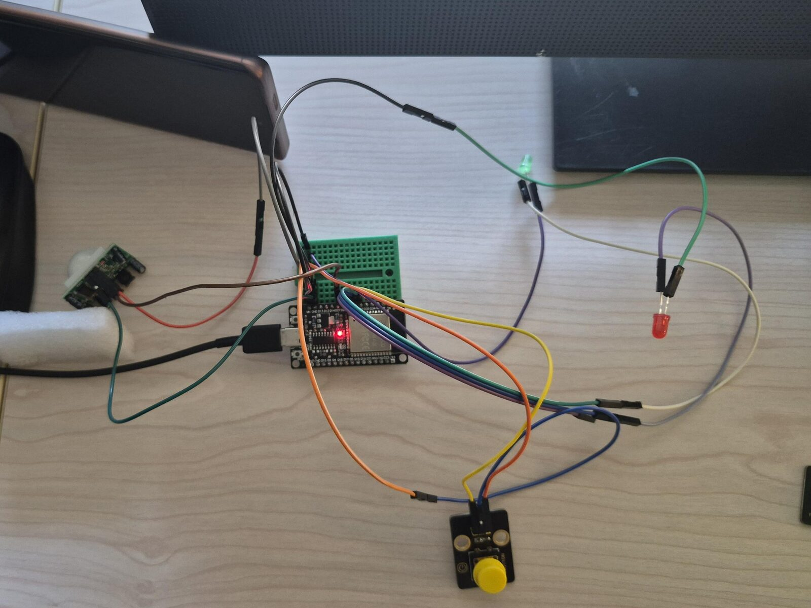
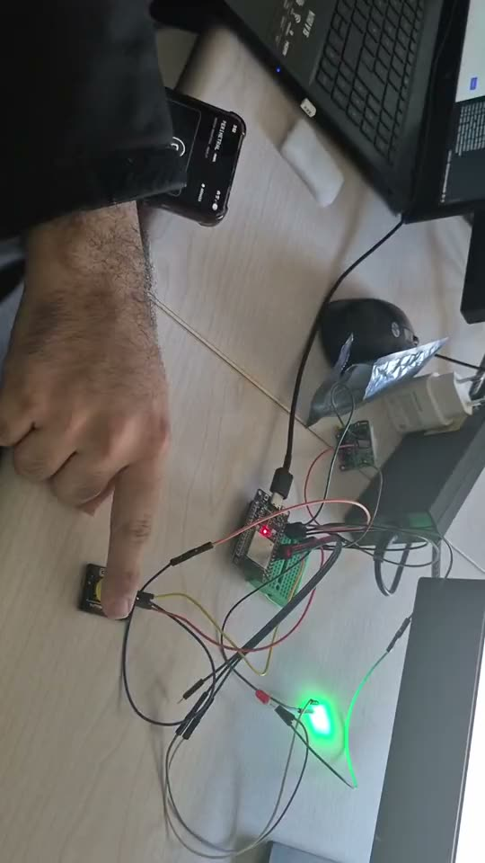
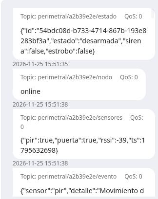

## 1. Datos del proyecto

- Ramo: TI3042, unidad 3.
- Integrantes: Brandon Moya, Benjamin Villa, Josue Vasquez.
- Sistema: alarma para bodega. Un nodo ESP32 con sensor de movimiento (PIR HC-SR501), sensor de puerta (reed), sirena y estrobo, y una app Android (Kotlin, Jetpack Compose, Firebase) que lo arma, lo desarma y recibe sus eventos por MQTT sobre TLS.

| Qué | Dónde |
|---|---|
| App Android | `app/` |
| Puente MQTT de la app | `app/src/main/java/com/example/network/Esp32MqttBridge.kt` |
| Firmware y circuito del ESP32 | `hardware/esp32-bodega/` (`sketch/sketch.ino`, `secrets.example.h`, `diagram.json`, `libraries.txt`) |
| Monitor MQTT para el PC | `hardware/esp32-bodega/mqtt_monitor.py` |
| APK | Releases de GitHub |

## 2. Esquema de conexiones


| Montaje | ESP32 |
|---|---|
|  |  |

| GPIO | Componente | Dirección | Detalle |
|---|---|---|---|
| 27 | PIR HC-SR501 (OUT) | Entrada | HIGH = movimiento. Alimentado con 5 V |
| 26 | Reed de puerta (en el montaje, un botón) | Entrada, pull-up interno | LOW = puerta cerrada. Antirrebote de 80 ms |
| 25 | Sirena | Salida | `tone()` alterna 1200 y 1800 Hz cada 400 ms. Sin buzzer en el montaje (sección 10) |
| 33 | LED de estrobo, 220 ohm | Salida | Parpadea cada 120 ms durante la alarma |
| 32 | LED de armado, 220 ohm | Salida | Encendido si el estado no es `desarmada` |

El circuito editable está en `hardware/esp32-bodega/diagram.json`. En Wokwi el reed es un interruptor deslizante (izquierda = cerrada).

En el video se arma desde la app (LED verde), se pulsa el botón de puerta, la app pasa a alarma con el estrobo parpadeando y luego se desarma:

<a href="docs/evidencia/prueba-alarma-fisica.mp4"></a>

## 3. Protocolo

MQTT sobre TLS (puerto 8883) en EMQX Cloud Serverless. Los temas cuelgan de `<canal>`, que debe ser igual en `CANAL` del sketch, `mqtt.channel` de la app y `MQTT_CANAL` del monitor.

| Tema | Sentido | Retenido | Contenido |
|---|---|---|---|
| `<canal>/estado` | app → nodo | sí, QoS 1 | `{"id":"<UUID, 1 a 36 caracteres>","estado":"desarmada"\|"armada"\|"alarma","sirena":bool,"estrobo":bool}` |
| `<canal>/ack` | nodo → app | no | `{"id","ok":bool,"motivo","ts"}`. `motivo` solo si `ok` es false |
| `<canal>/evento` | nodo → app | no | `{"sensor":"pir"\|"reed","detalle","ms","ts","id"}` |
| `<canal>/sensores` | nodo → app | sí, cada 15 s | `{"pir","puerta","rssi","ts"}` |
| `<canal>/nodo` | nodo → app | sí, última voluntad | `online` / `offline` |

`ts` es epoch UTC en segundos por NTP (0 si aún no sincroniza).

| Motivo de ERR | Cuándo |
|---|---|
| `json_invalido` | No se puede parsear |
| `no_es_objeto` | JSON válido pero no es un objeto |
| `clave_desconocida` | Trae una clave fuera del protocolo |
| `campo_faltante` | Falta `id`, `estado`, `sirena` o `estrobo` |
| `tipo_incorrecto` | Un campo tiene otro tipo |
| `id_invalido` | `id` vacío o de más de 36 caracteres |
| `estado_invalido` | `estado` no es `desarmada`, `armada` ni `alarma` |

La app muestra el último ACK o ERR en la pantalla Red y en la lista de eventos.

Pruebas contra el ESP32 físico, publicando en `<canal>/estado` y midiendo el tiempo hasta el ACK:

| Prueba | Resultado |
|---|---|
| 10 órdenes válidas, una a la vez | 10/10 `ok:true`. ACK entre 394 y 3089 ms, promedio 849 ms |
| Un mensaje inválido por motivo, seguido de una orden válida | Cada uno respondió con su motivo y no cambió el estado. La orden válida siguiente se aceptó siempre |
| 10 órdenes seguidas sin esperar ACK | 10 ACK `ok:true`, en orden |
| 65 s leyendo `<canal>/sensores` | 12 mensajes. `ts` a 0 a 3 s de la hora del PC. RSSI entre −49 y −62 dBm |

## 4. Seguridad

Controles de ISO/IEC 27001:2022, Anexo A:

| Control | Qué se aplicó | Evidencia |
|---|---|---|
| A.8.24 Uso de criptografía | MQTT por TLS en el 8883. El ESP32 fija la CA del broker (DigiCert Global Root G2, `red.setCACert(CA_BROKER)`) y rechaza certificados de otra autoridad. La app (Paho con `SSLSocketFactory`) valida la cadena y el host | En Wireshark, por el 1883 se leía el JSON; por el 8883 solo el handshake TLS |
| A.5.17 Información de autenticación | Usuario, clave del broker y canal fuera del repo: `secrets.h` en el firmware y `local.properties` en la app. El repo solo trae `secrets.example.h` | `git check-ignore -v hardware/esp32-bodega/sketch/secrets.h local.properties` los lista y `git ls-files` no los incluye. El broker rechaza una conexión con clave errónea |

Además, el ESP32 valida cada orden con `validarOrden()` antes de tocar los actuadores: lista blanca de claves, tipos obligatorios, `id` de 1 a 36 caracteres y tres estados posibles. Una orden inválida se descarta y se responde con ERR (pruebas en la sección 3).

### Qué quedaría expuesto

- Quien conozca el canal y tenga credenciales del broker puede leer eventos y publicar estados. App y nodo comparten credenciales.
- Los mensajes no van firmados: el broker los ve en claro y un cliente con credenciales puede enviar una orden válida.
- La clave WiFi y las credenciales del broker están sin cifrar en la flash del ESP32. Con el equipo y un cable USB se pueden leer.
- El enlace LAN entre teléfonos usa AES-GCM con una clave compartida por todos los dispositivos del usuario.

## 5. Datos personales

| Dato | Dónde viaja o se guarda | Protección |
|---|---|---|
| Correo y UID | Firebase Auth y `users/{uid}` en Firestore | TLS. Solo el dueño lee y escribe su documento |
| Token FCM | `users/{uid}/dispositivos/{deviceId}`, con rol, modelo y última conexión | TLS |
| Eventos (tipo, detalle, origen, hora) | MQTT, Room si no hay red y `sitios/{id}/eventos` | TLS. Las reglas impiden editarlos o borrarlos. No llevan nombre ni correo |
| Ubicación y `NEARBY_WIFI_DEVICES` | Se piden al abrir la app para leer el SSID | El SSID no sale del teléfono |
| Cámara (nodo-teléfono) | Análisis en el teléfono | No se guardan ni envían imágenes |

El ESP32 no maneja datos personales. La app no hace analítica.

## 6. Reconexión y plan de contingencia

- Firmware, sin bloquear el sensado: WiFi cada 4, 8, 16… s y MQTT cada 1, 2, 4… s, con tope de 60 s. Keepalive de 15 s. Al perder el WiFi corta la sesión MQTT.
- Última voluntad: el broker publica `offline` en `<canal>/nodo` si el nodo cae, y el nodo publica `online` al volver.
- App: reintenta cada 1 s doblando hasta 60 s, luego Paho reconecta solo y la app republica el estado.

| Falla | Qué pasa | Qué hace el usuario |
|---|---|---|
| Cae el WiFi de la bodega | El ESP32 sigue con el último estado y guarda los eventos en flash | Revisar el router. Al volver la red reenvía solo |
| Cae el broker | Se marca `offline`. El nodo sigue igual y la app reintenta | Esperar o revisar el deployment en EMQX Cloud |
| Corte de luz del ESP32 | Al arrancar recibe el último `estado` retenido. Los eventos en flash se conservan | Ver que el LED de armado coincida con la app |
| Teléfono sin internet | Los eventos quedan en Room y se suben al volver la red | Reconectar el teléfono. En modo ESP32 la app necesita internet para el broker |

Prueba: se expulsó al nodo del broker con un cliente que usó su mismo id. Se marcó `offline` y el nodo volvió a `online` a los 21,3 s. El primer ACK tras reconectar tardó 3,6 s.

## 7. Almacenamiento temporal

### App

- Room, tabla `eventos_pendientes`, con el id del evento como clave e inserción `IGNORE`, así que no hay duplicados.
- WorkManager (`SyncEventsWorker`) corre solo con red, sube cada evento con `document(id).set()` y lo borra de Room cuando el servidor confirma. Si Firestore lo rechaza por `PERMISSION_DENIED`, lo descarta para no bloquear la cola.

### ESP32 (flash, LittleFS)

- Guarda eventos solo mientras no hay MQTT, en `/pend.jsonl` y `/pend_viejo.jsonl`, de hasta 100 eventos cada uno (unos 24 KB en total). Al llenarse se descartan los 100 más antiguos.
- Sobrevive a reinicios y cortes de luz. Al reconectar reenvía en orden y borra cada archivo solo si el envío salió bien.
- Escribe una línea por evento, sin reescribir archivos, y LittleFS reparte el desgaste.
- Con QoS 0 un evento enviado justo antes del corte puede perderse. Por eso, al detectar el corte, los eventos de los últimos 30 s pasan de RAM a flash. Si alguno se duplica, la app lo descarta por id.
- Un evento que llega con más de 60 s de atraso se guarda con su hora real y no dispara la alarma.

Prueba con el nodo físico: se cortó la red y se generaron eventos con el botón y el PIR. El monitor serie mostró `Sin MQTT: evento guardado en flash` por cada uno, hasta 16. Al volver la red el nodo reconectó, publicó `estado`, `nodo` y `sensores`, y reenvió los eventos, cada uno con su `id` y la hora en que ocurrió.

| Monitor serie | Broker tras reconectar |
|---|---|
|  |  |
|  |  |

## 8. Consumo y compatibilidad

El nodo se alimenta por USB-C (5 V) y no usa batería: tiene que estar siempre en línea con el WiFi activo, y una batería duraría horas o pocos días.

| Componente | Reposo | Con alarma | Fuente |
|---|---|---|---|
| ESP32-WROOM-32 con WiFi | 80 mA | 80 mA (picos de TX de 160 a 260 mA) | Datasheet de Espressif |
| PIR HC-SR501 | 0,065 mA | 0,065 mA | Dato del proyecto (máximo en reposo) |
| Reed con pull-up interno | < 0,1 mA | < 0,1 mA | Estimado |
| LED de armado | 6 mA | 6 mA | (3,3 V − 2 V) / 220 ohm |
| LED de estrobo | 0 | 6 mA | Mismo cálculo |
| Sirena | 0 | 30 mA | Valor típico de un buzzer activo |
| Total | 86,2 mA (0,43 W) | 122,2 mA (0,61 W) | |

Para ahorrar energía, la app recibe todo por MQTT sin sondear, reintenta con espera creciente y solo sincroniza con red. El nodo publica al cambiar un sensor más un latido cada 15 s, y escribe en flash solo sin conexión.

La comunicación nodo-app va por WiFi y MQTT. El puerto serie USB se usa para cargar el firmware y depurar.

Compatibilidad: Android 8.0 o superior (`minSdk` 26, `targetSdk` 36), ABIs `arm64-v8a`, `armeabi-v7a` y `x86_64`. Probada en un Samsung SM-S936B con Android 17 y en Waydroid (LineageOS x86_64).

## 9. Cómo compilar

### App

```bash
ANDROID_HOME=~/Android/Sdk ./gradlew assembleDebug
# APK en app/build/outputs/apk/debug/app-debug.apk
```

Faltan en git y hay que agregarlos: `app/google-services.json` (Firebase), `debug.keystore` en la raíz y `local.properties` con el SDK y el broker:

```properties
mqtt.host=<host del broker>
mqtt.user=<usuario>
mqtt.password=<clave>
mqtt.channel=<canal>
```

### Firmware

1. Arduino IDE 2.x con el core esp32 de Espressif 3.3.x.
2. Librerías PubSubClient y ArduinoJson 7.
3. Copiar `sketch/secrets.example.h` a `secrets.h` y completar `WIFI_SSID`, `WIFI_PASS`, `MQTT_HOST`, `MQTT_USER`, `MQTT_PASS` y `CANAL`.
4. Abrir `sketch/sketch.ino`, elegir la placa ESP32 y el puerto, y cargar.

`mqtt_monitor.py` lee `MQTT_HOST`, `MQTT_USER`, `MQTT_PASS` y `MQTT_CANAL` del entorno.

## 10. Qué no funcionó

- Sirena: no teníamos buzzer y el GPIO25 quedó sin conectar. El sketch genera los tonos y en Wokwi suenan. En el montaje el nodo recibe la orden y responde el ACK, pero no suena nada.
- PIR KS6018 de un kit: la salida quedaba en HIGH o se activaba sola cada pocos segundos. Era falla del módulo; se cambió por un HC-SR501.
- Bluetooth entre teléfonos: nunca fue fiable y se reemplazó por un enlace WiFi LAN (WebSocket 8765, NSD y AES-GCM).
- Botón como reed: el rebote generaba eventos dobles. Se resolvió con un antirrebote de 80 ms.
- Con Wokwi muy lento (por ejemplo al 3 %), el ESP32 tarda minutos en conectar al broker.
- En modo ESP32 la app sigue mostrando las tarjetas de la red local, aunque no se usan.
