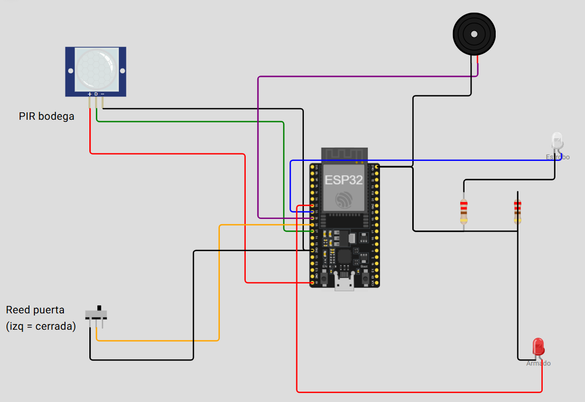

## 1. Datos del proyecto

- Proyecto: Perimetral, alarma perimetral para bodega.
- Ramo: TI3042 (unidad 3).
- Integrantes: <-- Brandon Moya, Benjamin Villa, Josue Vasquez-->

Perimetral detecta intrusos fuera de horario con un sensor de movimiento (PIR HC-SR501) y un sensor de puerta (reed), y activa una sirena y una luz estroboscópica. Tiene una app Android (Kotlin, Jetpack Compose y Firebase/Firestore) y un nodo ESP32 que se comunica con la app por MQTT sobre TLS.

### Cómo funciona

Hay un sitio en Firestore (`sitios/bodega_central`) y cada dispositivo cumple un rol:

- Panel: arma y desarma el sistema, configura zonas y horarios, y muestra los eventos.
- Nodo: tiene los sensores y la sirena. Se elige en el login con el selector "Nodo de sensores":

| Modo | Qué hace de nodo | Conexión con el panel |
|---|---|---|
| Teléfono | Otro celular: la cámara detecta movimiento y usa el parlante y el flash | Firestore + red local (WebSocket 8765 + NSD, cifrado con clave compartida) |
| ESP32 Wokwi | ESP32 simulado en wokwi.com | MQTT sobre TLS (EMQX Cloud Serverless, puerto 8883) |
| ESP32 físico | ESP32 real con PIR, reed, actuadores y LED | MQTT por el mismo broker |

En los modos ESP32 el teléfono siempre es panel. Para cambiar de modo hay que cerrar sesión (Seguridad, CERRAR SESIÓN). Cada sensor dispara la alarma solo si el sistema está armado y su zona está activa: PIR en ZN-05 y puerta en ZN-01.

### Dónde está cada cosa

| Qué | Dónde |
|---|---|
| App Android | `app/` (pantallas en `ui/screens`, lógica en `ui/viewmodel/AlarmViewModel.kt`) |
| Puente MQTT con el ESP32 | `app/src/main/java/com/example/network/Esp32MqttBridge.kt` |
| Enlace por la red local | `network/LocalMeshManager.kt` |
| Programa y circuito del ESP32 | `hardware/esp32-bodega/` (`sketch/sketch.ino`, `secrets.example.h`, `diagram.json`, `libraries.txt`, `README.md`) |
| Monitor MQTT desde el PC | `hardware/esp32-bodega/mqtt_monitor.py` |
| Guía paso a paso de las pruebas | `~/Proyectos/Perimetral-pruebas-wokwi.md` (fuera del repo) |
| APK compilada | Releases de GitHub del repositorio |
| Fuente Doto (licencia OFL) | `app/src/main/res/font/`, licencia en `OFL-Doto.txt` |

## 2. Esquema de conexiones



El circuito editable está en `hardware/esp32-bodega/diagram.json` (Wokwi). Pines definidos en `sketch/sketch.ino`:

| GPIO | Componente | Dirección | Detalle |
|---|---|---|---|
| 27 | PIR HC-SR501 (salida OUT) | Entrada | HIGH = movimiento. El módulo se alimenta con 5 V y GND |
| 26 | Reed de puerta (o botón) | Entrada con pull-up interno | Un lado a GND. LOW = puerta cerrada. Antirrebote de 80 ms |
| 25 | Sirena | Salida | `tone()` alterna 1200 y 1800 Hz cada 400 ms |
| 33 | LED estroboscópico (con resistencia de 220 ohm; con relé si fuera una luz real) | Salida | Medio periodo de destello de 120 ms |
| 32 | LED de sistema armado (con resistencia de 220 ohm) | Salida | Encendido si el estado no es `desarmada` |

En Wokwi el reed es un interruptor deslizante (izquierda = puerta cerrada).

## 3. Protocolo

El nodo y la app se hablan por MQTT sobre TLS (puerto 8883) en el broker EMQX Cloud Serverless. Todos los temas cuelgan de `<canal>`, un texto que tiene que ser igual en `CANAL` del sketch, en `mqtt.channel` (o el campo "Canal MQTT") de la app y en `MQTT_CANAL` del monitor. No hay canal por defecto.

| Tema | Sentido | Retenido | Contenido |
|---|---|---|---|
| `<canal>/estado` | app → nodo | sí, QoS 1 | `{"id":"<UUID, 1 a 36 caracteres>","estado":"desarmada"\|"armada"\|"alarma","sirena":bool,"estrobo":bool}`. Sin claves extra |
| `<canal>/ack` | nodo → app | no | `{"id","ok":bool,"motivo":"...","ts"}`. `motivo` solo aparece si `ok` es false (ERR) |
| `<canal>/evento` | nodo → app | no | `{"sensor":"pir"\|"reed","detalle","ms","ts","id"}` |
| `<canal>/sensores` | nodo → app | sí, cada 15 s (`LATIDO_MS`) | `{"pir","puerta","rssi","ts"}` |
| `<canal>/nodo` | nodo → app | sí, última voluntad | `online` / `offline` |

`ts` es el epoch UTC en segundos, tomado por NTP (`pool.ntp.org`). Vale 0 si el ESP32 todavía no sincronizó el reloj.

Motivos de ERR en el `ack`:

| Motivo | Cuándo |
|---|---|
| `json_invalido` | El mensaje no se puede parsear (corrupto o cortado) |
| `no_es_objeto` | El JSON es válido pero no es un objeto |
| `clave_desconocida` | Trae una clave que no está en el protocolo |
| `campo_faltante` | Falta `id`, `estado`, `sirena` o `estrobo` |
| `tipo_incorrecto` | Un campo tiene un tipo distinto del esperado |
| `id_invalido` | El `id` está vacío o tiene más de 36 caracteres |
| `estado_invalido` | `estado` no es `desarmada`, `armada` ni `alarma` |

La app muestra el ACK o ERR con su hora en `NetworkScreen` ("Última orden") y en la lista de eventos. Los ACK se guardan con el id `ack-<id>-<ts>`.

Ver los mensajes: `python mqtt_monitor.py`, o el cliente web de EMQX suscrito a `<canal>/#`. Para probar la sirena sin la app: `python mqtt_monitor.py --estado alarma` y después `--estado desarmada`, porque el estado queda retenido en el broker.

## 4. Seguridad

Referencias a ISO/IEC 27001:2022, Anexo A. Se aplicaron dos controles principales.

| Control | Qué se aplicó | Evidencia |
|---|---|---|
| A.8.24 Uso de criptografía | El tráfico MQTT va por TLS en el puerto 8883 (`MQTT_PORT` en `sketch.ino`). El ESP32 fija la CA del broker (DigiCert Global Root G2, constante `CA_BROKER`, `red.setCACert(CA_BROKER)` en `setup()`), así que rechaza un certificado de otra autoridad. La app (Paho con `SSLSocketFactory`) valida cadena y nombre de host | Captura de Wireshark ya hecha: en el puerto 1883 se leía el JSON, en 8883 solo el handshake TLS. Una conexión sin TLS al 1883 del broker debe fallar |
| A.5.17 Información de autenticación (con A.8.5) | Usuario y clave del broker y el canal están fuera del repositorio: `secrets.h` en el firmware y `local.properties` en la app (que los pasa a `BuildConfig`). `.gitignore` excluye `local.properties`, `debug.keystore` y `app/google-services.json`, y la regla `hardware/esp32-bodega/**/secrets.h` excluye el `secrets.h` del firmware. El repo solo trae `secrets.example.h` con valores de relleno | `git check-ignore -v hardware/esp32-bodega/sketch/secrets.h local.properties` los lista. `git ls-files \| grep -E "secrets.h\|local.properties\|google-services"` no debe listar nada. Una conexión al broker con clave errónea o sin credenciales es rechazada |

Integridad de las órdenes: el ESP32 valida cada mensaje de `estado` con ArduinoJson en `validarOrden()` antes de tocar los actuadores. Usa una lista blanca de claves (`id`, `estado`, `sirena`, `estrobo`), exige los cuatro campos con su tipo, limita el `id` a 1 a 36 caracteres y acepta solo tres valores de `estado`. Una orden inválida se descarta, se registra por Serial con su motivo y se responde con un ERR (motivos en la sección 3). En las pruebas en vivo (sección 9) cada motivo respondió bien y el estado no cambió.

### Qué quedaría expuesto

- El canal es un secreto compartido. Quien lo conozca y tenga credenciales del broker puede leer eventos y publicar estados. Las credenciales son las mismas para la app y el nodo, y no hay una por dispositivo.
- Los mensajes no van firmados. TLS protege el trayecto hacia el broker, pero el broker ve el contenido en claro y un cliente con credenciales válidas puede enviar una orden con formato correcto.
- La clave de WiFi y las credenciales del broker están en la flash del ESP32 sin cifrar. Quien tenga el equipo y un cable USB puede leerlas.
- El canal usado antes del cambio quedó en el historial de git. No hay que reutilizarlo: se eligió uno nuevo.
- El enlace LAN entre teléfonos usa AES-GCM con una clave compartida por todos los dispositivos del usuario.

## 5. Datos personales

| Dato | Dónde viaja o se guarda | Protección |
|---|---|---|
| Correo y UID de Firebase Auth | Firebase Auth y `users/{uid}` en Firestore (también `nombre` y fecha de creación) | TLS de Firebase. Las reglas solo dejan leer y escribir `users/{uid}` a su dueño |
| Token FCM | Lo genera Firebase Cloud Messaging para las notificaciones y se guarda en `users/{uid}/dispositivos/{deviceId}` junto al rol, el modelo del equipo y la última conexión (`DeviceRoleRepository`) | TLS de Firebase |
| Eventos de seguridad (tipo, detalle, origen, marca de tiempo) | MQTT hasta la app, Room en el teléfono si no hay red y `sitios/{id}/eventos` en Firestore | TLS en MQTT y Firestore. Las reglas impiden editar o borrar eventos. No llevan nombre ni correo |
| Permisos de ubicación y `NEARBY_WIFI_DEVICES` | Se piden al abrir la app (`MainActivity`) para leer el SSID de la WiFi y decidir el enlace local. Declarados: `ACCESS_FINE_LOCATION` y `ACCESS_COARSE_LOCATION` | El SSID no sale del teléfono: lo usan `LocalWifiManager`, `MainActivity` y `NetworkScreen` para mostrarlo. No se guarda en Firestore |
| Cámara (solo modo nodo-teléfono) | El análisis de movimiento corre en el teléfono | No se guardan ni se envían imágenes: `MotionDetectorAnalyzer` compara cuadros en memoria y solo emite el evento de movimiento |

El ESP32 no maneja datos personales: publica estados de sensores y eventos con `id` aleatorio. La app no hace perfilado ni analítica propia.

## 6. Reconexión y plan de contingencia

Reintentos automáticos:

- Firmware (no bloqueante: el sensado y la sirena siguen funcionando): WiFi cada 4, 8, 16... s y MQTT cada 1, 2, 4... s, ambos con tope de 60 s. Vuelven al mínimo al conectar.
- Keepalive MQTT de 15 s (`mqtt.setKeepAlive(15)`). Al perder el WiFi el firmware corta la sesión MQTT de inmediato (`mqtt.disconnect()`), para no publicar sobre un socket muerto.
- Última voluntad (LWT): el nodo registra `offline` en `<canal>/nodo` (retenido) y publica `online` al conectar.
- App: la primera conexión reintenta cada 1 s, doblando hasta 60 s. Después de conectar, la reconexión la hace Paho (`isAutomaticReconnect`) y la app republica el estado en cada reconexión.

| Falla | Qué pasa | Qué hace el usuario |
|---|---|---|
| Cae el WiFi de la bodega | El ESP32 sigue leyendo sensores y manejando la sirena con el último estado recibido. Los eventos van al buffer de flash. Reintenta el WiFi con espera creciente | Revisar el router. Al volver la red se reconecta y reenvía los eventos solo |
| Cae el broker (EMQX) | El broker publica `offline` por la última voluntad. El ESP32 mantiene la misma conducta local y el mismo buffer. La app reintenta | Esperar. Si dura, revisar el deployment en EMQX Cloud |
| Corte de luz o reinicio del ESP32 | Arranca, sincroniza NTP, reconecta y recibe el último `estado` retenido, con lo que vuelve al estado armado o desarmado en que estaba. Los eventos pendientes en flash sobreviven | Comprobar que el LED de armado coincide con el panel. Si no, reenviar el estado desde la app |
| Teléfono sin internet | Los eventos de la app se guardan en Room y `SyncEventsWorker` los sube cuando vuelve la red. Las órdenes se encolan en la caché offline de Firestore. Con panel y nodo-teléfono en la misma WiFi sigue el enlace LAN, que no necesita internet | Conectar ambos teléfonos a la misma WiFi. En modo ESP32 el panel necesita internet para alcanzar el broker |

## 7. Almacenamiento temporal

### App (Room + WorkManager)

- Room 2.7.0, tabla `eventos_pendientes`. La clave primaria es el id del evento y la inserción usa `IGNORE`, así que un evento repetido no se duplica.
- WorkManager 2.10.0: `SyncEventsWorker`, trabajo único (`sync-eventos`) con la restricción `NetworkType.CONNECTED`, o sea que solo corre con red. Sube cada evento con `document(id).set()` y lo borra de Room solo después de que el servidor lo confirma.
- Si las reglas de Firestore rechazan un evento (ya existe o es inválido, `PERMISSION_DENIED`), se descarta para no bloquear la cola. Con cualquier otro error se reintenta más tarde.
- Un trabajo nuevo reemplaza al que espera reintento (`ExistingWorkPolicy.REPLACE`).

### ESP32 (flash, LittleFS; no usa tarjeta SD)

- Solo guarda eventos (no los latidos de `sensores`) y solo mientras no hay MQTT.
- Dos archivos, `/pend.jsonl` y `/pend_viejo.jsonl`, de hasta 100 eventos cada uno. Un evento ocupa unos 119 bytes, así que el total es de unos 24 KB y el tope es de 200 eventos.
- Persiste a reinicios y cortes de corriente. Se borra solo después de reenviar: al reconectar se mandan en orden (primero el viejo). Si un envío falla, el archivo se conserva.
- Al llenarse el archivo actual se borra el viejo (se pierden los 100 más antiguos) y el actual pasa a ser el viejo.
- Un Upload normal desde el Arduino IDE no borra la flash de datos. Para vaciarla a mano hay que usar "Erase All Flash" o esperar a la reconexión.
- Desgaste: se agrega una línea por evento y nunca se reescribe el archivo completo. LittleFS reparte las escrituras entre sectores. Una flash típica aguanta del orden de 100 000 ciclos por sector.
- QoS 0 no confirma entrega, así que un evento publicado justo antes de un corte puede perderse en el socket muerto. Por eso los últimos 20 eventos enviados quedan en RAM y, al detectar el corte, los de los últimos 30 s (`VENTANA_DUDA_MS`, algo más de 1,5 veces el keepalive) pasan a flash. El reenvío puede duplicar alguno: la app deduplica por id.
- Un evento reenviado con `ts` más de 60 s atrasado se registra con su hora real y la nota "(registrado sin conexión a las HH:mm:ss)", y no dispara la alarma.
- Límite: si se corta la corriente, se pierden los eventos de esa ventana de 30 s que estaban solo en RAM.

## 8. Consumo y compatibilidad

El nodo va alimentado por USB-C desde un computador (5 V). No usa batería: la alarma debe estar siempre en línea y el WiFi queda activo para recibir órdenes y publicar el latido, con lo que una batería se agotaría en horas o pocos días.

Consumo por componente, a 5 V de entrada:

| Componente | Reposo (armado, sin alarma) | Con alarma | Fuente |
|---|---|---|---|
| ESP32-WROOM-32, WiFi conectado, promedio | 80 mA | 80 mA (con picos de TX de 160 a 260 mA) | Datasheet ESP32-WROOM-32 de Espressif v2.2 a 2.4: operación promedio 80 mA, RX 80 a 90 mA, TX 160 a 260 mA |
| PIR HC-SR501 | 0,065 mA | 0,065 mA | Menos de 65 µA en reposo, según el dato del proyecto. Se usa el máximo |
| Reed / botón con pull-up interno | menos de 0,1 mA | menos de 0,1 mA | Estimado: 3,3 V sobre el pull-up interno (unos 45 kohm, valor típico del ESP32 sin reconfirmar) con la puerta cerrada |
| LED de armado (GPIO32, 220 ohm) | 6 mA | 6 mA | Estimado: (3,3 V − 2 V) / 220 ohm, LED rojo |
| LED de estrobo (GPIO33, 220 ohm) | 0 | 6 mA (promedio, parpadea) | Estimado, mismo cálculo |
| Sirena (GPIO25) | 0 | 30 mA | Estimado: valor típico de un buzzer activo, sin datasheet del modelo |
| Total (peor caso) | 86,2 mA (0,43 W) | 122,2 mA (0,61 W) | Suma de lo anterior |

Cálculo del total en reposo: 80 + 0,065 + 0,1 + 6 = 86,2 mA, y a 5 V son 0,43 W. Con alarma se suman 6 mA del estrobo y 30 mA de la sirena: 122,2 mA y 0,61 W. El README anterior daba 136 y 172 mA porque contaba 50 mA para el PIR del kit KS6018, que se reemplazó por el HC-SR501. El regulador lineal del módulo baja de 5 V a 3,3 V con la misma corriente, por eso los mA a 3,3 V se suman como mA a 5 V.

Referencia con un powerbank de 10 000 mAh (estimación): 10 Ah × 3,7 V = 37 Wh; con 85 % de eficiencia del convertidor a 5 V quedan unos 31,5 Wh. En reposo (0,43 W) duraría unas 73 h y con alarma continua (0,61 W), unas 51 h. La eficiencia del 85 % es un supuesto.

Optimización de batería en el teléfono:

- Sin sondeo: las novedades llegan por MQTT (push), la app no consulta al broker en intervalos.
- Reconexión con espera creciente (1 a 60 s), así que un corte largo no mantiene la radio intentando cada segundo.
- WorkManager solo con red: `SyncEventsWorker` no corre si no hay conexión.

En el nodo, los eventos se publican solo al cambiar el sensor, el latido va cada 15 s, el buffer de flash se escribe solo sin conexión y la sirena y el estrobo solo se activan en alarma.

Nota sobre la "comunicación serial" de la guía: se hace por WiFi y MQTT. El puerto serie USB se usa para flashear el ESP32 y para depurar (monitor serie).

### Compatibilidad

- Android: `minSdk` 26, `targetSdk` 36.
- ABIs: `arm64-v8a`, `armeabi-v7a`, `x86_64`.
- Probado en un Samsung Galaxy SM-S936B con Android 17 / One UI 9 y en Waydroid 1.6.3 (imagen oficial LineageOS x86_64, VANILLA) en el computador de desarrollo.

## 9. Pruebas

### En vivo contra el ESP32 físico

Pruebas hechas por MQTT contra el nodo real, con un script que publica en `<canal>/estado` y mide el tiempo hasta el ACK.

| Prueba | Condición | Resultado |
|---|---|---|
| Órdenes válidas | 10 órdenes alternando armada y desarmada, una a la vez (normal) | 10/10 con `ok:true`. Latencia del ACK: mínima 394 ms, promedio 849 ms, máxima 3089 ms. Típico 0,4 a 0,9 s |
| Órdenes inválidas | Un mensaje por cada motivo, y a continuación una orden válida | `json_invalido`, `no_es_objeto`, `clave_desconocida`, `campo_faltante`, `tipo_incorrecto`, `id_invalido` (id vacío y de 40 caracteres) y `estado_invalido` respondieron con el motivo correcto. Ninguna cambió el estado, y la orden válida siguiente se aceptó cada vez (410 a 759 ms) |
| Ráfaga | 10 órdenes seguidas sin esperar el ACK | Llegaron los 10 ACK, todos `ok:true` y en el mismo orden |
| Tras reconectar | Se expulsó al nodo del broker con un cliente que usó su mismo id | El broker marcó `offline` y el nodo volvió a `online` a los 21,3 s. El primer `sensores` llegó a los 21,4 s. El primer ACK tras reconectar tardó 3,6 s |
| Nodo online retenido | Suscripción nueva a `<canal>/nodo` | Entregó `online` retenido |
| Sensores y reloj | 65 s de lectura de `<canal>/sensores` | Llegaron 12 mensajes (cada cambio de sensor más el latido). El `ts` del nodo difirió 0 a 3 s de la hora del PC. RSSI entre −49 y −62 dBm |

Al terminar se restauró el estado `desarmada` que tenía el nodo antes de las pruebas.

### Pendientes de registrar

| Prueba | Condición | Resultado |
|---|---|---|
| Buffer en flash con el firmware nuevo | Cortar el WiFi, generar eventos y restaurarlo | <!-- pendiente --> |
| Corte de red dentro de la ventana de 30 s | Cortar la red justo después de un evento | <!-- pendiente --> |
| App en modo avión | Eventos en Room y sincronización al volver la red | <!-- pendiente --> |
| Actuadores a la vista | Sirena, estrobo y LED de armado ante `alarma` y `armada` | <!-- pendiente --> |

### Pruebas anteriores en Wokwi (2026-11-18)

- [x] El ESP32 conecta al WiFi y al broker.
- [x] Un estado `alarma` publicado enciende la sirena y el estrobo.
- [x] Llegan los eventos de la puerta (`reed`) y de movimiento (`pir`), con `id`.
- [x] La app se instala y abre en Waydroid sin fallas.
- [x] En el login, el selector de nodo y el campo "Canal MQTT" funcionan en los tres modos.

## 10. Cómo compilar

### App

```bash
ANDROID_HOME=~/Android/Sdk ./gradlew assembleDebug
# APK en app/build/outputs/apk/debug/app-debug.apk
```

Archivos locales que no están en git:

- `app/google-services.json`, del proyecto de Firebase.
- `debug.keystore` en la raíz.
- `local.properties` con la ruta del SDK y los datos del broker (sin `mqtt.host` el puente MQTT no conecta):

```properties
mqtt.host=<host del broker>
mqtt.user=<usuario>
mqtt.password=<clave>
mqtt.channel=<canal>
```

### Firmware

1. Instalar Arduino IDE 2.x y el core esp32 de Espressif 3.3.x.
2. Instalar las librerías PubSubClient y ArduinoJson 7 (`hardware/esp32-bodega/libraries.txt`).
3. Copiar `hardware/esp32-bodega/sketch/secrets.example.h` a `secrets.h` en la misma carpeta y completar `WIFI_SSID`, `WIFI_PASS`, `MQTT_HOST`, `MQTT_USER`, `MQTT_PASS` y `CANAL`.
4. Abrir `sketch/sketch.ino`, elegir la placa ESP32 y el puerto, y cargar.

El monitor del PC (`mqtt_monitor.py`) lee `MQTT_HOST`, `MQTT_USER`, `MQTT_PASS` y `MQTT_CANAL` del entorno.

## 11. Qué no funcionó

- Sirena con buzzer: no había un buzzer disponible, así que la sirena se representa con otro actuador. El sketch la maneja con `tone()` en el GPIO25 (dos tonos alternados) y el circuito de Wokwi usa un buzzer en ese pin. [PENDIENTE: indicar qué actuador se conectó en el GPIO25 del equipo físico.]
- Sensor de movimiento anterior: el módulo PIR KS6018 ("PIR motion", 3 pines S/V/G, de un kit) dejaba la salida en HIGH todo el tiempo o se activaba y desactivaba cada pocos segundos sin movimiento. La falla estaba en el módulo y no en el código. Se cambió por un HC-SR501 y funcionó.
- Bluetooth: el enlace Bluetooth entre teléfonos se quitó el 2026-10-23 porque nunca funcionó de forma fiable. Se usa un enlace WiFi LAN con WebSocket (puerto 8765), NSD y AES-GCM.
- Botón usado como reed: con un botón en lugar del reed, un solo accionamiento puede generar un doble evento por rebote. El firmware aplica un antirrebote de 80 ms (`ANTIRREBOTE_MS`).

### Limitaciones conocidas

- El broker es EMQX Cloud Serverless. Antes de usarlo en producción hay que revisar los límites de conexiones y tráfico del plan.
- En modo ESP32 la app sigue mostrando las tarjetas de la red local, aunque no se usan.
- Con la simulación de Wokwi muy lenta (por ejemplo al 3 %), el ESP32 puede tardar minutos en conectar o reconectar al broker. Se arregla reiniciando la simulación con menos carga en el PC.
- En el panel, los botones "Simular ZN-04/05/06" quedan bajo la barra inferior. Se alcanzan desplazando la lista.
- El proyecto de Wokwi no está guardado en ninguna cuenta. Para usarlo hay que crear un proyecto ESP32 nuevo y pegar los archivos de `hardware/esp32-bodega/`.
- Si Waydroid deja de responder a adb (`No route to host`), se reinicia con `waydroid session stop` y luego `waydroid show-full-ui`.
- Pendiente de prueba: sesión completa en modo ESP32 Wokwi (armar desde la app, disparar el PIR o abrir la puerta, comprobar que la app pasa a ALARMA y que el ESP32 enciende la sirena).
