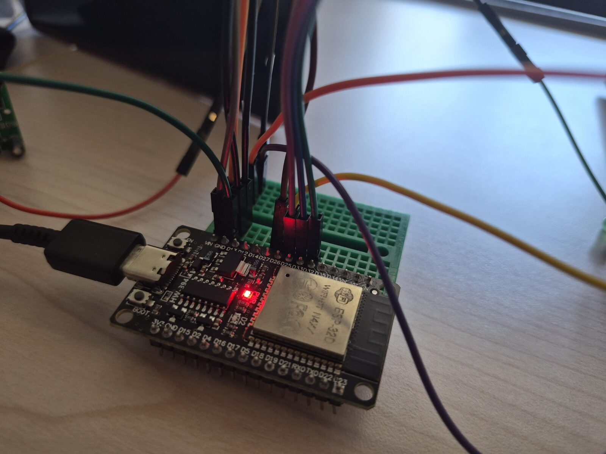
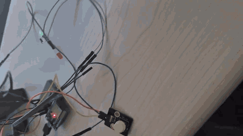
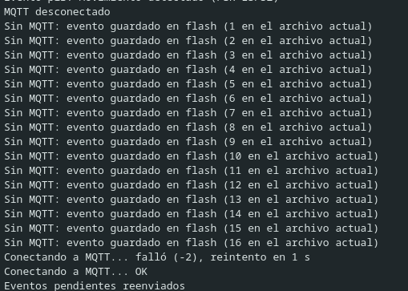
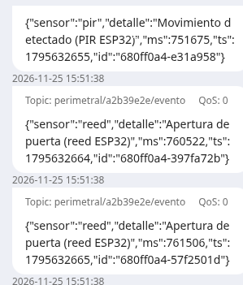
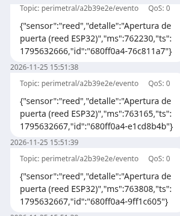

# Perimetral

## 1. Datos del proyecto

| | |
|---|---|
| Integrantes | Brandon Moya · Benjamin Villa · Josue Vasquez |
| Ramo | Aplicaciones Móviles para IoT (TI3042) |
| Sección | D-FB50-N4-P13-C1(E-F)/D, San Pedro de la Paz |
| Problema que resuelve | Una bodega queda sin vigilancia fuera de horario y nadie se entera de una intrusión hasta el día siguiente |
| Qué hace el sistema | Detecta movimiento y apertura de puerta con el sistema armado, activa sirena y estrobo, y avisa en la app, que arma, desarma y guarda los eventos |
| Placa | ESP32 DevKit con módulo ESP32-WROOM-32 |
| Sensores | PIR HC-SR501 (movimiento), reed de puerta (en el montaje, un botón) |
| Actuadores | Sirena (buzzer, GPIO25), LED de estrobo, LED de sistema armado |
| Enlace | WiFi, MQTT sobre TLS (broker EMQX Cloud Serverless, puerto 8883) |

## 2. Esquema de conexiones

| Montaje | ESP32 |
|---|---|
|  |  |

| Pin ESP32 | Componente | Observación |
|---|---|---|
| GPIO27 | PIR HC-SR501 (OUT) | Entrada. HIGH = movimiento. Módulo alimentado con 5 V |
| GPIO26 | Reed de puerta (botón en el montaje) | Entrada con pull-up interno, otro lado a GND. LOW = cerrada. Antirrebote de 80 ms |
| GPIO25 | Sirena | Salida. `tone()` alterna 1200 y 1800 Hz cada 400 ms. Sin buzzer en el montaje (sección 11) |
| GPIO33 | LED de estrobo | Salida, resistencia de 220 ohm. Parpadea cada 120 ms |
| GPIO32 | LED de sistema armado | Salida, resistencia de 220 ohm. Encendido si el estado no es `desarmada` |

El circuito editable está en `hardware/esp32-bodega/diagram.json` (Wokwi).

Prueba en el montaje: se arma desde la app (LED verde), se pulsa el botón de puerta, la app pasa a alarma con el estrobo parpadeando y luego se desarma. [Video en MP4](docs/evidencia/prueba-alarma-fisica.mp4).

## 3. Protocolo de comunicación

Formato de trama: JSON sobre MQTT, un mensaje por tema bajo `<canal>/`. El canal debe ser igual en `CANAL` del sketch, `mqtt.channel` de la app y `MQTT_CANAL` del monitor. Largo máximo: 512 bytes (`mqtt.setBufferSize(512)`). Una trama incompleta o corrupta se descarta sin tocar los actuadores y el ESP32 responde ERR con `json_invalido`.

| Dirección | Tema | Parámetros | Rango válido | Respuesta |
|---|---|---|---|---|
| App → ESP32 | `<canal>/estado` (retenido, QoS 1) | `id`, `estado`, `sirena`, `estrobo` | `id`: texto de 1 a 36 caracteres. `estado`: `desarmada`, `armada` o `alarma`. `sirena`, `estrobo`: bool. Sin claves extra | `<canal>/ack` con `{"id","ok":true,"ts"}` o `{"id","ok":false,"motivo","ts"}` |
| ESP32 → App | `<canal>/evento` | `sensor`, `detalle`, `ms`, `ts`, `id` | `sensor`: `pir` o `reed` | La app lo guarda como evento y dispara la alarma si el sistema está armado y la zona activa |
| ESP32 → App | `<canal>/sensores` (retenido, cada 15 s) | `pir`, `puerta`, `rssi`, `ts` | bool, bool, dBm | La app lo muestra en la pantalla Red |
| ESP32 → App | `<canal>/nodo` (retenido, última voluntad) | texto | `online` / `offline` | La app muestra el ESP32 en línea o fuera de línea |

`ts` es epoch UTC en segundos por NTP (0 si aún no sincroniza). `ms` son los milisegundos desde el arranque.

Códigos de error: `json_invalido` (no se puede parsear), `no_es_objeto`, `clave_desconocida`, `campo_faltante`, `tipo_incorrecto`, `id_invalido` (vacío o de más de 36 caracteres), `estado_invalido`.

Pruebas contra el ESP32 físico:

| Prueba | Resultado |
|---|---|
| 10 órdenes válidas, una a la vez | 10/10 `ok:true`. ACK entre 394 y 3089 ms, promedio 849 ms |
| Un mensaje inválido por cada código, seguido de una orden válida | Cada uno respondió con su código y no cambió el estado. La orden válida siguiente se aceptó siempre |
| 10 órdenes seguidas sin esperar ACK | 10 ACK `ok:true`, en orden |

## 4. Seguridad

| # | Control | Cómo está aplicado (archivo/línea) | Cómo lo comprobaron |
|---|---|---|---|
| 1 | Cifrado TLS con CA fijada (ISO/IEC 27001 A.8.24) | `sketch.ino`: `MQTT_PORT` 8883 y `red.setCACert(CA_BROKER)` en `setup()` (DigiCert Global Root G2). App: Paho con `SSLSocketFactory`, que valida cadena y host (`Esp32MqttBridge.kt`) | Wireshark: por el 1883 se leía el JSON, por el 8883 solo el handshake TLS |
| 2 | Autenticación en el broker y validación de órdenes (A.5.17) | Usuario y clave propios en EMQX. El ESP32 valida cada orden en `validarOrden()` con lista blanca de claves y tipos antes de actuar | El broker rechaza una conexión con clave errónea o sin credenciales. Las órdenes inválidas responden ERR y no cambian el estado (sección 3) |

Qué quedaría expuesto sin estos controles: sin TLS, cualquiera en la misma red o en el trayecto leería los eventos y el canal. Sin credenciales ni validación, un tercero podría publicar en `<canal>/estado` y desarmar la alarma o apagar la sirena.

Manejo de credenciales: la clave WiFi, el usuario y la clave del broker y el canal están en `hardware/esp32-bodega/sketch/secrets.h` y en `local.properties` de la app, ambos fuera de Git (`.gitignore`). El repositorio trae `secrets.example.h` con valores falsos.

Alineación con ISO 27000: un solo usuario de broker para el sistema, solo el puerto TLS 8883, sin puertos abiertos en el ESP32 (solo cliente saliente) y órdenes aceptadas únicamente si cumplen el formato.

Limitaciones: app y nodo comparten credenciales, los mensajes no van firmados y las credenciales quedan sin cifrar en la flash del ESP32.

## 5. Datos personales

| Dato | ¿Viaja por el enlace? | ¿Se guarda? ¿Dónde? | Cómo se protege |
|---|---|---|---|
| Correo y UID del usuario | No (solo app ↔ Firebase) | Firebase Auth y `users/{uid}` en Firestore | TLS. Solo el dueño lee y escribe su documento |
| Token de notificaciones (FCM) | No | `users/{uid}/dispositivos/{deviceId}` | TLS. Solo el dueño |
| Eventos de la alarma (tipo, hora) | Sí, por MQTT | Room en el teléfono si no hay red, y Firestore | TLS. No llevan nombre ni correo. Las reglas impiden editarlos o borrarlos |
| SSID de la WiFi (pide permiso de ubicación) | No | No | Solo se muestra en la app |

El ESP32 no maneja datos personales: publica estados de sensores y eventos con un `id` aleatorio.

## 6. Reconexión y plan de contingencia

Reconexión automática en la app: espera inicial de 1 s, crece x2 hasta un tope de 60 s. Reinicia la cuenta al conectar. Después Paho reconecta solo y la app vuelve a publicar el estado. El ESP32 hace lo mismo con MQTT (1 s a 60 s) y con el WiFi (4 s a 60 s), sin bloquear el sensado.

Estados visibles en la pantalla Red: Broker "Conectado" / "Sin conexión", ESP32 "En línea" / "Fuera de línea", y la última orden con ACK o ERR y su hora.

| Falla | Qué detecta el sistema y cómo | Qué hace | Cómo se recupera |
|---|---|---|---|
| Se pierde el enlace app–ESP32 | Keepalive MQTT de 15 s. El broker publica `offline` (última voluntad) | El ESP32 mantiene el último estado y guarda los eventos en flash. La app muestra el ESP32 fuera de línea | Reconecta sola y reenvía los eventos guardados |
| El ESP32 se apaga o reinicia | La app ve `offline` en `<canal>/nodo` | Al arrancar sincroniza NTP y recibe el último `estado` retenido | Vuelve al estado armado o desarmado que tenía. Los eventos en flash se conservan |
| La app se cierra o se cae | El ESP32 no depende de la app | Sigue sensando y actuando con el último estado | Al abrir, la app reconecta y recibe los temas retenidos |
| Sensor entrega datos inválidos | Antirrebote de 80 ms en la puerta y rearme de 3 s en el PIR | Ignora los rebotes y las repeticiones | No detecta un sensor atascado (sección 11) |
| Teléfono sin internet | La app no alcanza Firestore | Guarda los eventos en Room | `SyncEventsWorker` los sube al volver la red |

Estado seguro del actuador: ante cualquier corte el ESP32 conserva el último estado recibido. Si estaba en alarma, la sirena y el estrobo siguen hasta que llegue la orden de desarmar.

Prueba: se expulsó al nodo del broker con un cliente que usó su mismo id. Se marcó `offline` y el nodo volvió a `online` a los 21,3 s. El primer ACK tras reconectar tardó 3,6 s.

## 7. Almacenamiento temporal sin conexión

En la app (Room): los eventos sin subir quedan en la tabla `eventos_pendientes`. Estar en la tabla es la marca de no sincronizado. `SyncEventsWorker` (WorkManager, solo con red) los sube a Firestore con `document(id).set()` y los borra de Room cuando el servidor confirma. El id del evento es la clave primaria y la inserción es `IGNORE`, así que no hay duplicados. Si un envío falla, el evento sigue en la tabla.

En el ESP32 (flash):

| Dato | Valor |
|---|---|
| Mecanismo | LittleFS, archivos `/pend.jsonl` y `/pend_viejo.jsonl` |
| Tamaño de cada lectura | Unos 119 bytes (un evento JSON por línea) |
| Espacio asignado | Unos 24 KB (2 archivos de 100 eventos) |
| Lecturas que caben | 200 eventos |
| Qué pasa cuando se llena | Se borra el archivo viejo (los 100 más antiguos) y el actual pasa a ser el viejo |
| Cómo se protege la flash del desgaste | Solo escribe sin conexión, agrega una línea por evento sin reescribir el archivo y LittleFS reparte las escrituras |
| Cómo se vacía al reconectar | Reenvía en orden, primero el archivo viejo, y borra cada archivo solo si el envío salió bien |

Como QoS 0 no confirma la entrega, al detectar un corte los eventos de los últimos 30 s pasan de RAM a flash. Si alguno llega dos veces, la app lo descarta por id.

Prueba con el nodo físico: se cortó la red y se generaron eventos con el botón y el PIR. El monitor serie mostró `Sin MQTT: evento guardado en flash` por cada uno, hasta 16. Al volver la red el nodo reconectó, publicó `estado`, `nodo` y `sensores`, y reenvió los eventos con su `id` y la hora en que ocurrieron.

Monitor serie:

Broker tras reconectar:

| Estado, nodo y sensores | Eventos reenviados | Eventos reenviados |
|---|---|---|
|  |  |  |

## 8. Consumo de energía

Alimentación del prototipo: USB-C desde un computador, 5 V, sin batería.

| Componente | Estado | Corriente (mA) | Fuente del dato | % del tiempo en ese estado | Corriente promedio (mA) |
|---|---|---:|---|---:|---:|
| ESP32-WROOM-32 | Activo con WiFi | 80 | Datasheet ESP32-WROOM-32 (Espressif), operación promedio | 100 | 80 |
| PIR HC-SR501 | Midiendo | 0,065 | Dato del proyecto, máximo en reposo | 100 | 0,065 |
| Reed con pull-up interno | Puerta cerrada | 0,1 | Estimado: 3,3 V sobre unos 45 kohm | 100 | 0,1 |
| LED de armado | Encendido | 6 | (3,3 V − 2 V) / 220 ohm | 100 | 6 |
| LED de estrobo | Parpadeando | 6 | Mismo cálculo, promedio | 0 | 0 |
| Sirena | Sonando | 30 | Valor típico de un buzzer activo | 0 | 0 |
| **Total** | | | | | **86,2 mA** |

Se supone el sistema armado todo el tiempo y sin alarmas. Con la alarma sonando el total sube a 122,2 mA.

Si el proyecto no va a batería: el nodo tiene que estar siempre en línea con el WiFi activo para recibir órdenes y publicar el latido, así que va enchufado. Como referencia, con un powerbank de 10 000 mAh la autonomía sería 10 000 × 0,8 ÷ 86,2 = unas 93 horas.

Consumo de la app en el móvil: mantiene una conexión MQTT abierta mientras hay sesión, y sincroniza los eventos pendientes cuando vuelve la red.

Decisiones para ahorrar energía: la app recibe por MQTT sin sondear y reintenta con espera creciente hasta 60 s. WorkManager solo corre con red. El ESP32 publica al cambiar un sensor más un latido cada 15 s y escribe en flash solo sin conexión.

## 9. Compatibilidad

| | |
|---|---|
| `minSdk` | 26 (Android 8.0), la versión que introdujo los canales de notificación que usa la app para las alertas |
| `targetSdk` | 36 |
| Arquitecturas / ABIs | arm64-v8a, armeabi-v7a, x86_64 |

| Dispositivo | Android | Arquitectura | Resultado |
|---|---|---|---|
| Samsung Galaxy SM-S936B | 17 (One UI 9) | arm64-v8a | Funciona |
| Waydroid (LineageOS) en PC | 13 | x86_64 | Funciona |

## 10. Cómo compilar y ejecutar

Firmware: Arduino IDE 2.x, placa "ESP32 Dev Module" (core esp32 de Espressif 3.3.x), librerías PubSubClient y ArduinoJson 7 (`hardware/esp32-bodega/libraries.txt`). Copiar `sketch/secrets.example.h` a `secrets.h` en la misma carpeta, completar `WIFI_SSID`, `WIFI_PASS`, `MQTT_HOST`, `MQTT_USER`, `MQTT_PASS` y `CANAL`, y cargar `sketch/sketch.ino`.

App: Android Studio o Gradle desde la terminal (`./gradlew assembleDebug`). Hacen falta `app/google-services.json` de Firebase y `local.properties` con `mqtt.host`, `mqtt.user`, `mqtt.password` y `mqtt.channel`. El APK está en la sección Releases del repositorio.

Orden de arranque para la demostración:

1. Conectar el ESP32 por USB-C y esperar `Conectando a MQTT... OK` en el monitor serie.
2. Abrir la app, elegir "ESP32 físico" en el login, escribir el canal e iniciar sesión.
3. En la pantalla Red, comprobar Broker "Conectado" y ESP32 "En línea".
4. Armar desde la app y activar el PIR o el botón de puerta.

## 11. Qué no funcionó y qué mejoraríamos

- Sirena: no teníamos buzzer y el GPIO25 quedó sin conectar. El sketch genera los tonos y en Wokwi suenan. En el montaje el nodo recibe la orden y responde el ACK, pero no suena nada.
- PIR KS6018 de un kit: la salida quedaba en HIGH o se activaba sola cada pocos segundos. Era falla del módulo; se cambió por un HC-SR501. El firmware no detecta un sensor atascado.
- Botón como reed: el rebote generaba eventos dobles. Se resolvió con un antirrebote de 80 ms.
- Bluetooth entre teléfonos: nunca fue fiable y se reemplazó por un enlace WiFi en la red local.
- Mejoraríamos: credenciales distintas por dispositivo, mensajes firmados y credenciales cifradas en la flash del ESP32.
